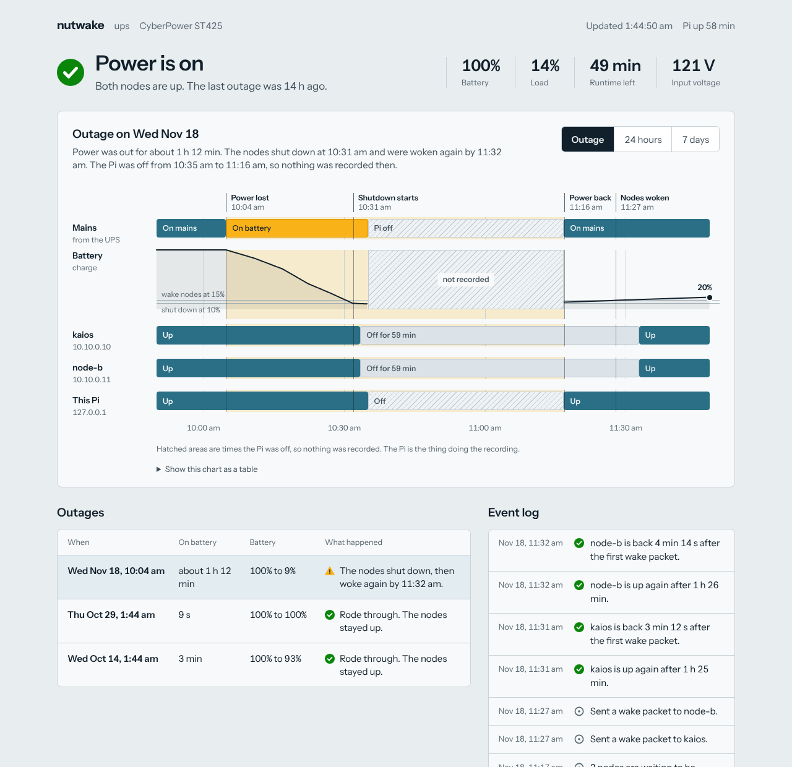
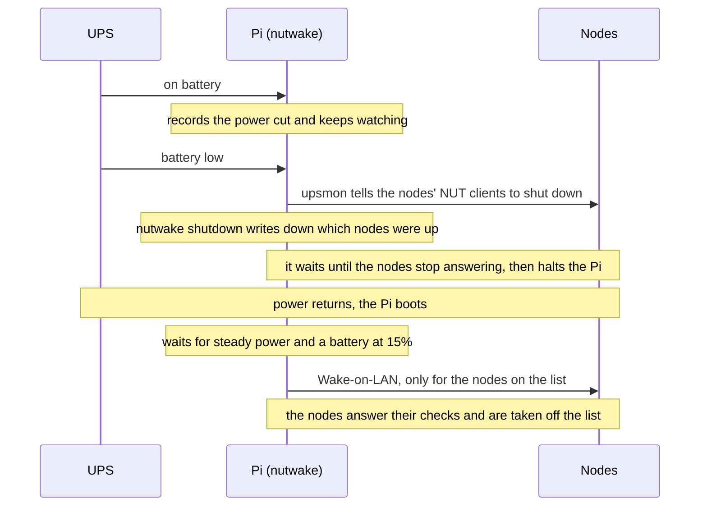

<h1 align="center">
  <picture>
    <source media="(prefers-color-scheme: dark)" srcset="docs/logo-dark.svg">
    
  </picture>
</h1>

<p align="center">A NUT-aware shutdown helper, Wake-on-LAN and a status page, in one small Go binary.</p>

It is for a homelab where a Raspberry Pi watches a UPS (through [NUT](https://networkupstools.org/)) and other machines, the nodes, run on that UPS. When the power goes out:

- the nodes are shut down cleanly, and the Pi waits until they are really off before it halts itself
- when power comes back, the Pi wakes only the nodes that the power cut shut down, and only once power has been steady and the battery has recharged a little
- a read-only status page shows what happened, minute by minute, including the stretch when the Pi itself was off



The page above comes from `nutwake demo`, which runs it on made-up data. You can try it without a UPS.

## How a power cut plays out



The details are in [How it works](docs/guide/how-it-works.md).

## Install

Download the binary for your Pi from the [latest release](https://github.com/gureetk/nutwake/releases): `nutwake-linux-arm64` for a 64-bit system, `nutwake-linux-armv7` for a 32-bit one, or `nutwake-linux-amd64` for x86-64. Each release has a `SHA256SUMS` file to check them against. To build it yourself, install Go and run `make cross`.

Then follow the [install guide](docs/guide/install.md), which takes you from the binary to a plug-pull test.

## Guide

The guide is on the website at https://gureetk.github.io/nutwake/guide/, and the same pages are in [`docs/guide`](docs/guide/README.md).

- [Install](docs/guide/install.md)
- [Set up NUT](docs/guide/nut.md)
- [Set up Wake-on-LAN](docs/guide/wake-on-lan.md)
- [How it works](docs/guide/how-it-works.md)
- [Commands](docs/guide/commands.md)
- [The status page](docs/guide/status-page.md)
- [Security](docs/guide/security.md)
- [Limits](docs/guide/limits.md)

## Status

The code is tested with a fake UPS and fake nodes, including a whole power cut from the first loss of mains to the wake packets (`go test ./cmd/nutwake`). It has not yet been run against a real UPS and real nodes. The systemd unit, ping with its capability, and Wake-on-LAN on real network cards are exactly the parts that tests here cannot cover, so run `nutwake check` and do the plug-pull test in the [install guide](docs/guide/install.md) before you trust it.

## Development

```sh
make check    # gofmt, go vet and go test -race
make cross    # static binaries for arm64, armv7 and x86-64 in dist/
go run ./cmd/nutwake demo -scene battery
make site     # builds the website into _site/ (needs Python 3, and pip install -r site/requirements.txt)
```

Releases are built by the `release` workflow. Push a tag (`git tag v0.1.0 && git push origin v0.1.0`), or open the Actions tab, choose `release`, and give it the tag to create. It runs `make check`, builds the three binaries, writes `SHA256SUMS` and publishes the release. The commit has to be on main. A version that starts with `v0.`, or has a hyphen like `v1.0.0-rc1`, is marked as a pre-release. If `.github/releases/<tag>.md` exists it becomes the release notes; otherwise GitHub writes them from the merged pull requests.

The packages under `internal/` each do one thing: `nut` reads the UPS, `probe` checks nodes, `wol` builds and sends the packet, `monitor` watches, `waker` wakes, `shutdown` is the helper, `events`, `samples` and `state` keep the history, `clocksync` copes with a Pi that has no clock battery, `web` is the page, and `demo` builds the made-up history. `cmd/nutwake` puts them together.

## Licence

MIT, see [LICENSE](LICENSE). The page uses the Instrument Sans font under the SIL Open Font License; the text is in `internal/web/assets/fonts/OFL.txt`.
