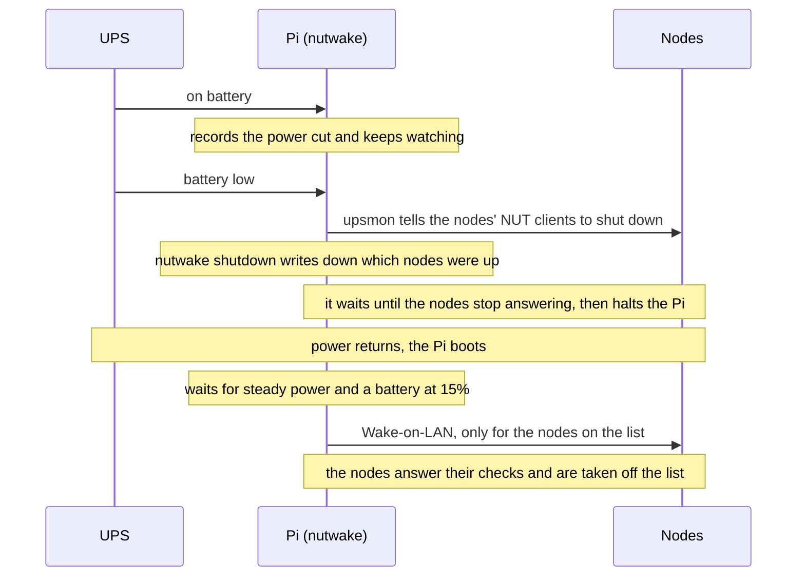

# nutwake

A NUT-aware shutdown helper, Wake-on-LAN and a status page, in one small Go binary.

It is for a homelab where a Raspberry Pi watches a UPS (through [NUT](https://networkupstools.org/)) and other machines, the nodes, run on that UPS. When the power goes out:

- the nodes are shut down cleanly, and the Pi waits until they are really off before it halts itself
- when power comes back, the Pi wakes only the nodes that the power cut shut down, and only once power has been steady and the battery has recharged a little
- a read-only status page shows what happened, minute by minute, including the stretch when the Pi itself was off


The page above comes from `nutwake demo`, which runs it on made-up data. You can try it without a UPS.

## How a power cut plays out



The details:

- **A power cut is recorded** as soon as the UPS reports it, and the record survives a restart of nutwake or the Pi.
- **A node counts as down** after `probe.down_after` failed checks in a row. The check is a ping (`icmp`) or a connection to a port (`tcp:8006` is a good "Proxmox has finished booting" check).
- **The shutdown helper** (`nutwake shutdown`) is what upsmon runs when the battery is low. It writes down the nodes that were up when power was lost and any that are up now, waits up to `shutdown.wait_for_nodes` for them to power off, and then halts the Pi. A node is off only when both its own check and a plain ping get no answer. The Pi halts even if the wait ran out, the history cannot be written, or the configuration cannot be read.
- **Waking** starts after the Pi boots. The nodes on the list are woken only when the UPS is on mains and has been for `wake.delay`, and the battery is at `wake.min_battery` (15% unless you change it). If the battery never gets there, the nodes are woken anyway after `wake.max_wait`. Packets are spaced by `wake.stagger`, repeated every `wake.retry_interval` for nodes that have not answered, and given up on after `wake.give_up_after`. If power fails again while this is going on, it waits again. A node you started by hand, or one that never went down, is left alone.
- **The Pi has no clock battery.** After a boot its clock is wrong until it reaches an NTP server, so events and battery readings are held back until the clock is set and then written with the right time. If the clock is still unset after `history.clock_sync_timeout`, they are written anyway and marked as such.

## Install

You need a Pi (or any Linux machine) that can reach the UPS through NUT, and the nodes on the same network. The steps below assume Raspberry Pi OS or Debian.

**1. Build and install the binary.** With Go installed:

```sh
make cross
uname -m          # aarch64 means a 64-bit system, armv7l a 32-bit one
sudo install -m 0755 dist/nutwake-linux-arm64 /usr/local/bin/nutwake   # or nutwake-linux-armv7
nutwake version
```

**2. Create the user the daemon runs as.**

```sh
sudo install -m 0644 contrib/nutwake.sysusers /usr/lib/sysusers.d/nutwake.conf
sudo systemd-sysusers
sudo install -d -m 0755 -o nutwake -g nutwake /var/lib/nutwake
```

**3. Write the configuration.** Only `nodes` is required.

```sh
sudo install -d -m 0755 -o root -g root /etc/nutwake
sudo install -m 0644 -o root -g root config.example.yaml /etc/nutwake/config.yaml
sudoedit /etc/nutwake/config.yaml
```

Every setting is explained in [`config.example.yaml`](config.example.yaml). Keep the file, and the directory it is in, owned by root and writable by nobody else. See [Security](#security) for why.

**4. Check it.** This tests the configuration, reads the UPS, pings each node and finds the halt command, and says what is wrong in plain words:

```sh
sudo -u nutwake nutwake check
```

**5. Start the daemon.**

```sh
sudo install -m 0644 contrib/nutwake.service /etc/systemd/system/nutwake.service
sudo systemctl daemon-reload
sudo systemctl enable --now nutwake
```

The status page is at the address in `listen` (`127.0.0.1:8080` by default, which only the Pi itself can reach; use the Pi's own address or `0.0.0.0:8080` to reach it from elsewhere, and read [Security](#security) first).

**6. Hand the shutdown to nutwake.** Put the `SHUTDOWNCMD` line from [`contrib/upsmon.conf.example`](contrib/upsmon.conf.example) in `/etc/nut/upsmon.conf` and restart upsmon (`sudo systemctl restart nut-monitor`). Then see what it would do, without doing it:

```sh
sudo nutwake shutdown --dry-run
```

**7. Pull the plug.** Nothing replaces this. With the nodes running, unplug the UPS from the wall, watch the status page, and plug it back in once the nodes are off and the Pi has halted. Do it once before you rely on it.

## Set up NUT

nutwake reads the UPS from NUT's server (`upsd`). It needs no password for that. This is the usual layout: the Pi is the NUT primary, and each node runs its own NUT client that shuts the node down when the Pi says so.

On the Pi (the lines that matter):

```
# /etc/nut/nut.conf
MODE=netserver

# /etc/nut/ups.conf
[ups]
    driver = usbhid-ups
    port = auto

# /etc/nut/upsd.conf: listen for nutwake on loopback and for the nodes on the LAN
LISTEN 127.0.0.1 3493
LISTEN 192.168.1.5 3493

# /etc/nut/upsd.users
[upsmon]
    password = choose-one
    upsmon primary

# /etc/nut/upsmon.conf
MONITOR ups@localhost 1 upsmon choose-one primary
SHUTDOWNCMD "/usr/local/bin/nutwake shutdown -config /etc/nutwake/config.yaml"
```

On each node:

```
# /etc/nut/nut.conf
MODE=netclient

# /etc/nut/upsmon.conf
MONITOR ups@192.168.1.5 1 upsmon choose-one secondary
```

NUT before version 2.8 spells `primary` as `master` and `secondary` as `slave`. The name in `[ups]` must match `nut.ups` in nutwake's configuration.

## Set up Wake-on-LAN

Wake-on-LAN is the part that most often needs work, and it is set up on the nodes, not in nutwake. Do this for each node.

**In the BIOS or UEFI,** turn on Wake-on-LAN (it may be called "Power on by PCI-E" or similar). Set "Restore on AC power loss" to "Last state" or "Power off", **not** "Power on". With "Power on" the node starts the moment the UPS has power again, which skips the wait for the battery.

**On the network card,** Wake-on-LAN must be set to `g`:

```sh
ethtool nic0 | grep Wake-on      # "Wake-on: g" is what you want
sudo ethtool -s nic0 wol g       # turns it on until the next reboot
ethtool -P nic0                  # the permanent MAC address: this is the `mac` for the node
```

To keep it across reboots on Proxmox (or any machine using `/etc/network/interfaces`), add a line under the card's stanza:

```
iface nic0 inet manual
    post-up /usr/sbin/ethtool -s nic0 wol g
```

Use the MAC of the physical card, not of a bridge such as `vmbr0`.

**On the network,** the Pi's wake packet is a broadcast, so the Pi must be on the same network segment (the same VLAN) as the nodes. Set `wake.broadcast` to your subnet's broadcast address, for example `192.168.1.255:9`. The default, `255.255.255.255:9`, is dropped by some switches and routers. If the Pi and the nodes are on different VLANs, give the Pi an interface in the nodes' VLAN, or the packet will not arrive. Check that the Pi can ping each node.

To test, shut a node down by hand and run `nutwake wake <name>` from the Pi.

## Commands

| Command | What it does |
| --- | --- |
| `nutwake serve` | Runs the daemon: watches the UPS and the nodes, wakes nodes when power is back, and serves the status page. |
| `nutwake shutdown` | The helper for upsmon's `SHUTDOWNCMD`. Waits for the nodes to power off, then halts this machine. |
| `nutwake shutdown --dry-run` | Shows what the helper would do, and changes nothing. |
| `nutwake wake <node>...` | Sends a wake packet now. `-all` wakes every node. |
| `nutwake check` | Tests the configuration, the UPS, the nodes, the halt command and the wake settings. Exits 1 if something fails. |
| `nutwake demo` | Serves the status page with made-up data. `-scene online`, `battery` or `waiting` picks the moment; `-addr` picks the address. |
| `nutwake version` | Prints the version. |

Every command takes `-config <file>`, which defaults to `/etc/nutwake/config.yaml` or `$NUTWAKE_CONFIG`. To change a setting, edit the file and run `sudo systemctl restart nutwake`.

## The status page

The page shows the UPS and the nodes right now, and a recorder chart for the last power cut, the last 24 hours or the last 7 days: mains, the battery charge with the wake and shutdown levels, each node, and the Pi. Where the Pi was off, the chart is hatched, because nothing was recording. It also lists the power cuts, with what happened to the nodes in each, and the event log. There is a table version of the chart for screen readers, and a layout for narrow screens.

The page can only read. It answers `GET` and `HEAD`, nothing it is sent is stored or run, and it loads nothing from outside the Pi. Times are shown in the time zone of whoever is looking.

## Security

- **The status page has no login.** Anyone who can reach it can see when you are out and whether your nodes are up. Keep it on your LAN. If you listen on more than loopback, limit who can reach the port with the firewall, for example by adding a rule like this to your input chain: `tcp dport 8080 ip saddr 192.168.1.0/24 accept`, followed by a rule that drops the rest.
- **The page is read-only on purpose.** The shutdown command runs as root, so a page that could change settings would be a way to run commands on the Pi. Settings are shown on the page, but changed in the file.
- **The daemon runs as the `nutwake` user** with only the permission to ping, and cannot write outside `/var/lib/nutwake`. The shutdown helper runs as root because upsmon runs it.
- **The helper does not trust a configuration that others can change.** Running as root, if the configuration file or its directory belongs to someone other than root or can be written by anyone else, the helper ignores `shutdown.command` and halts with `/sbin/shutdown -h +0`. `nutwake check` warns about it.

## Limits to know about

- **`shutdown.wait_for_nodes` has to fit in what the UPS has left.** The helper starts when the UPS signals a low battery, and the battery runs out some minutes later. If the wait is longer than that, the Pi may lose power before it halts. The default is 5 minutes. Look at how long your UPS really lasts at that point, and keep the wait shorter.
- **Prefer a `tcp:<port>` probe, or have `ping` installed.** The `icmp` probe runs the `ping` command (`iputils-ping`). `nutwake check` says if it is missing.
- **nutwake halts the Pi but does not switch the UPS off.** That is NUT's job, through `upsmon` and the UPS driver's shutdown. Either way, nodes set to stay off after a power loss are woken by nutwake when it is time.
- **One UPS and one Pi.** There is no clustering and no second watcher. If the Pi is off when the power comes back, nothing wakes the nodes.
- **No alerts.** It records and shows. It does not send email or messages.
- **Configuration is read at start.** Restart the service after a change.

## Status

The code is tested with a fake UPS and fake nodes, including a whole power cut from the first loss of mains to the wake packets (`go test ./cmd/nutwake`). It has not yet been run against a real UPS and real nodes. The systemd unit, ping with its capability, and Wake-on-LAN on real network cards are exactly the parts that tests here cannot cover, so run `nutwake check` and do the plug-pull test above before you trust it.

## Development

```sh
make check    # gofmt, go vet and go test -race
make cross    # static binaries for arm64, armv7 and x86-64 in dist/
go run ./cmd/nutwake demo -scene battery
```

The packages under `internal/` each do one thing: `nut` reads the UPS, `probe` checks nodes, `wol` builds and sends the packet, `monitor` watches, `waker` wakes, `shutdown` is the helper, `events`, `samples` and `state` keep the history, `clocksync` copes with a Pi that has no clock battery, `web` is the page, and `demo` builds the made-up history. `cmd/nutwake` puts them together.

## Licence

MIT, see [LICENSE](LICENSE). The page uses the Instrument Sans font under the SIL Open Font License; the text is in `internal/web/assets/fonts/OFL.txt`.
